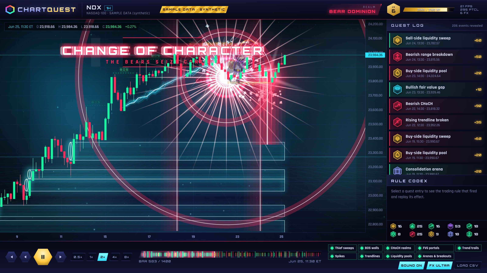

# ChartQuest — gamified market-structure charting (prototype v0.1)

Candlesticks from **TradingView Lightweight Charts**, with a **PixiJS** game layer on top.
Rule-based market-structure events (BOS, CHoCH, liquidity sweeps, FVGs…) trigger cinematic
effects anchored to their exact candle, price and confirmation time.

> **Data notice:** the bundled NDX series is **SAMPLE DATA**. It's a deterministic synthetic
> NASDAQ-100-like hourly series, not historical prices, and it's labelled that way in the UI.
> To use real data, drop a CSV into `data/` or load one from the UI (see below).
> There's no trading, order routing or brokerage code.



## Run it locally (safe preview)

```bash
cd /opt/chartquest          # or wherever the repo folder `chartquest/` is checked out
npm ci
npm run build && npm start  # http://127.0.0.1:3100  (bound to localhost only)
# or: npm run dev           # hot reload, also 127.0.0.1:3100
```

Both scripts bind to **127.0.0.1**, so nothing is reachable from outside the VPS and no Nginx change
is needed. To view it from your laptop, use an SSH tunnel:

```bash
ssh -N -L 3100:127.0.0.1:3100 user@your-vps
# then open http://localhost:3100 locally
```

Requires Node ≥ 20.9 (developed on Node 22). No API keys and no paid services. Fonts are
self-hosted through `@fontsource`, so the browser makes no third-party requests.

### Controls
| Control | Action |
|---|---|
| ▶ / Space | Play / pause the historical replay |
| ◀ ▶ / ← → | Step one candle back / forward |
| 0.5× … 8× | Replay speed (1× ≈ 2.2 candles/s) |
| Timeline | Scrub to any bar (events up to that bar appear already formed, without cinematics) |
| Mouse wheel / drag | Zoom / pan the chart (effects stay glued to their candles) |
| Effect chips | Turn each effect family on or off |
| SOUND ON/OFF, M | Mute the synthesised SFX |
| FX ULTRA/LITE | Particle budget and bloom (lite for weaker GPUs) |
| LOAD CSV | Load your own OHLC CSV in the browser (`time,open,high,low,close[,volume]`). It's parsed and analysed locally |
| Quest Log entry | Jump to the event, show the rule that fired, and replay its effect |

## Architecture

```
src/core/            framework-free domain layer (reusable by a future ingestion service)
  types.ts           Candle, MarketEvent (index, confirmIndex, levels, rule text)
  indicators.ts      ATR (Wilder), EMA
  detect/            rule-based detectors, all causal
    swings.ts        fractal pivots (3/3), confirmed 3 bars later
    structure.ts     BOS / CHoCH (close beyond last unbroken confirmed swing)
    liquidity.ts     equal-high/low pools + sweeps (wick through, close back inside ×2 bars)
    fvg.ts           3-candle imbalance ≥ 0.5×ATR, mitigation tracking
    momentum.ts      strong trend (efficiency ratio + ATR move + EMA21) and spikes (≥2.6×ATR)
    range.ts         consolidation arena (14 bars ≤ 3.2×avg ATR) + breakout (close ±0.2×ATR)
    trendline.ts     2-swing rising/falling lines, break on close ±0.25×ATR
  sample.ts          seeded synthetic NDX-like generator (clearly labelled)
  csv.ts             OHLC CSV parser
src/server/          ingestion: MarketDataProvider interface → sample + data/*.csv providers
src/app/api/market   GET /api/market?symbol=NDX-SAMPLE  ·  ?list  (ingest → detect → JSON)
src/game/            PixiJS engine
  engine.ts          two canvases around the transparent chart: back = environment, front = FX
  anchor.ts          ChartMapper: (candle index, price) → pixels, recomputed every frame
  particles.ts       pooled ParticleContainer system (one procedural atlas, additive + normal)
  textures.ts        procedural texture atlas (glow, spark, flame, smoke, shard, block, orb…)
  persistent.ts      state-derived overlays: FVG portals, pools, arenas, trails, BOS/CHoCH tags
  environment.ts     regime-reactive nebula, perspective floor, ambient motes
  Thief.ts           vector-drawn rigged thief character (sneak / grab / run / leap)
  effects/           one-shot cinematics (structure, CHoCH, spike, trendline, breakout, sweep…)
  audio.ts           WebAudio SFX, synthesised (no files)
src/ui/              React HUD: top bar, Quest Log, Rule Codex, replay deck
```

### Keeping the game layer in sync
* The chart owns time and price. Each frame the engine builds a `ChartMapper` from
  `timeScale().logicalToCoordinate` (integer bars, then linear per-bar spacing) and
  `series.priceToCoordinate`. Every effect stores **(candle index, price)** plus pixel offsets, never
  absolute screen positions, so zoom, pan and resize can't make effects drift.
* Persistent overlays are drawn from *(events visible at the replay head)* every frame, so seeking
  backwards or forwards always produces the right state.
* `npm run e2e` checks this: across default, zoom-in, zoom-out and pan views, the engine's anchor
  positions match the chart's own coordinates with **0.000 px** error.

### No look-ahead in replay
Every event has a `confirmIndex`: the first candle at whose **close** the rule is fully satisfied
(e.g. a swing needs 3 more bars; a sweep needs the next candle to close back inside). The replay only
reveals events with `confirmIndex ≤ head`. Persistent objects that end later (an FVG being mitigated,
a range breaking) carry an `endIndex` that's ignored until the head reaches it.
`tests/causality.test.ts` reruns detection on dozens of truncated prefixes and asserts the output is
identical to the full run up to that bar. Any detector that peeks at future candles fails it.

## Effect map

| Trading event | Animation | Screenshot |
|---|---|---|
| Liquidity sweep | Thief sneaks along the level, steals liquidity orbs from the swept wick, escapes into the unrevealed future with a smoke-bomb exit | `01-03` |
| Bullish BOS | Resistance wall of blocks forms on the broken level, cracks, blocks blast upward | `04` |
| Bearish BOS | Support floor cracks and collapses block by block (domino), dust | `05` |
| Bullish / bearish CHoCH | Shockwaves, an energy curtain sweeping the arena, realm recolour (environment, UI accent), glitch banner | `06` |
| Fair Value Gap | Glowing energy zone with a spinning portal ring and drifting motes | `10` |
| Strong bullish trend | Neon-green energy trail under the lows, comet ignition, spark wake | `11` |
| Strong bearish trend | Fiery red/orange trail over the highs, flames | `00`, `06` |
| Price spike | Fireball, sparks, smoke column, shockwave, lingering flames, screen shake | `07` |
| Trendline break | Electric fracture crawling along the line, arcs, flying shards | `08` |
| Liquidity pool | Pulsing gold level, ripples, floating orbs, BUY/SELL-SIDE tag | `02`, `12` |
| Consolidation | Arena with force walls, rising pillars, scanning beam | `12` |
| Breakout | Energy beam bursting through the boundary, shard spray | `09` |

## Tests

```bash
npm run typecheck
npm test          # detector causality, determinism, unique ids, all families present
npm run build
npm start &       # then:
npm run e2e       # sync + UI causality + console-error check, writes PNGs to docs/screenshots
```

## Status

**Done (v0.1)**
- Next.js + TS app, Lightweight Charts candles with zoom and pan, transparent chart sandwiched between two Pixi canvases
- Modular ingestion (provider interface, sample + CSV providers, `/api/market`), server-side detection
- 10 rule-based event families with no look-ahead, rule text shown in the Rule Codex
- 12 effect types, including the animated thief character, particle systems, trails, bloom-lite glow, screen shake and flashes
- Replay with play/pause/step/scrub/speed, per-effect toggles, mute, quality toggle, CSV import
- Regime-reactive environment (bull/bear realm), XP and levels, Quest Log, event counts
- Unit tests and e2e sync verification, screenshots

**Pending / next**
- The 4 visual reference images weren't attached to the brief, so the current art direction is my
  own interpretation (neon synthwave arena). Send them and I'll match palette, framing and character style.
- Real NASDAQ history: this build environment couldn't reach market-data hosts. Add a CSV to `data/`
  (e.g. `data/QQQ-1h.csv`) or implement a vendor `MarketDataProvider` (Polygon, Alpaca, etc.).
- Live streaming provider (websocket → incremental detection), multi-timeframe, symbol switcher UI
- Three.js layer (e.g. a 3D CHoCH realm portal), deliberately left out of v0.1 for performance
- Sprite-sheet / skeletal (Spine) art for the thief and more characters; custom GLSL shaders (shockwave displacement, heat haze)
- Adaptive music layers, settings persistence, mobile layout polish, accessibility (reduced-motion mode)
- Tuning detector thresholds on real data and making them user-configurable
